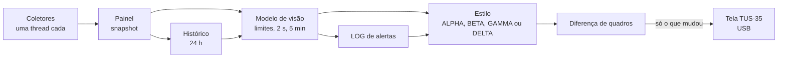

<!-- README | GAMMA TUS-35 | versão 3.0.0 | 07/11/2026 22:20 (-03) | criação original (Claude, para Lucas Tavares) -->
<!-- histórico: 3.0.0 07/11/2026 22:20 revisão completa para a v1.8.2: quatro estilos, GAMMA DELTA, alertas, LOG, capturas reais -->
<!-- histórico: 1.0.0 02/11/2026 19:20 primeira página (SENTINELA e DOSÍMETRO) -->

<div align="center">

# GAMMA TUS-35

**Painel de monitoramento do PC para a telinha USB TURZX / Turing de 3,5", no Linux.**

Verde fluorescente, hexágonos e brilho: CPU, GPU, RAM, discos, ventoinhas, bomba do water cooler, rede, clima e o gabinete de discos externo, tudo numa tela vertical de 320x480 pixels.


<sub>ALPHA, BETA, GAMMA e DELTA, desenhados pelo próprio código com os dados de demonstração (não são fotos da tela).</sub>

</div>

---

## O que é

O GAMMA transforma uma tela USB barata de 3,5" (TURZX / Turing Smart Screen TUS-35, USB `1a86:5722`) num painel de saúde do computador que fica ao lado do monitor. Ele roda como extensão do projeto de código aberto [turing-smart-screen-python](https://github.com/mathoudebine/turing-smart-screen-python), mas não usa os widgets prontos dos temas: o quadro inteiro é desenhado em Python com Pillow e só as regiões que mudaram são enviadas pela USB.

A ideia central é que **a tela diga em um segundo se está tudo bem**. Cada número tem cor de saúde (verde, âmbar, vermelho), e um indicador no topo resume o pior estado do sistema em três níveis: **N0 NORMAL**, **N1 AVISO** e **N2 ALERTA**.

## Os estilos

| | GAMMA ALPHA | GAMMA BETA | GAMMA GAMMA | GAMMA DELTA |
|---|---|---|---|---|
| Ideia | Favo de 19 hexágonos com os números e linhas de texto abaixo | O ALPHA mais compacto, com o gabinete de discos | 7 hexágonos de resumo e painel numérico por grupo | O GAMMA com gráficos de 24 h, alertas em destaque e LOG |
| Destaque | Escala N0/N1/N2, percentuais, bomba e ventoinhas | Percentuais entre parênteses, 4 baias do TerraMaster | CORE no centro, OK, ATEN ou CRIT por grupo, temperatura de cada disco | Pico de 24 h nos gráficos, total dos HDs num hexágono, barra de uso da RAM, LOG dos alertas |
| Pacote | `Gamma-Alpha-v1.8.3.zip` | `Gamma-Beta-v1.8.3.zip` | `Gamma-Gamma-v1.8.3.zip` | `Gamma-Delta-v1.8.3.zip` |

O **GAMMA DELTA** é o mais novo e o recomendado; é o que roda na tela do PC de referência.

<div align="center">


<sub>GAMMA DELTA nos estados normal, atenção e crítico (dados de demonstração). Valor em alerta aparece com fundo âmbar ou vermelho.</sub>
</div>

Detalhes de cada estilo em [docs/estilos.md](docs/estilos.md).

## O que aparece na tela

- **CPU:** uso, temperatura, frequência e carga média.
- **GPU NVIDIA:** uso, temperatura, frequência, VRAM, consumo e limite em watts, percentual da ventoinha e FPS dos jogos (via MangoHud).
- **RAM:** uso, disponível e temperatura dos pentes DDR5.
- **Discos:** uso, espaço livre e temperatura de cada disco (NVMe direto, HDD pelo módulo `drivetemp`), inclusive discos criptografados com VeraCrypt ou LUKS.
- **Gabinete TerraMaster (DAS USB):** as 4 baias com capacidade, uso e estado (montado, desmontado ou livre), detectadas sozinhas.
- **Total dos HDs** (DELTA): soma de todos os discos e baias montados, num hexágono que se enche com o uso.
- **Refrigeração:** RPM da bomba, do radiador e das ventoinhas do gabinete.
- **Rede:** velocidade, totais, Ethernet e Wi-Fi, ping com uma casa decimal e estado da internet.
- **Gráficos de 24 h** (DELTA): temperatura de CPU e GPU, VRAM com RAM e rede, com o pico do dia marcado.
- **LOG** (DELTA): os últimos alertas âmbar e vermelhos, com hora e leitura.
- **Sistema e clima:** data, hora, tempo ligado e o tempo da sua cidade (Open-Meteo).

## Alertas

Os limites vêm dos manuais, dos valores gravados no próprio hardware e das boas práticas de monitoramento (Zabbix). Exemplos: CPU 88/94 °C (Tjmax 95 °C do Ryzen 9 9900X), NVMe 80/90 °C (aviso de 89,85 °C gravado no SSD), RAM 90/95 %, discos 80/90 %, ping acima de 20/100 ms. Contra ruído de leitura, uma leitura contínua só muda de cor depois de 2 s; para dar tempo de ver, âmbar e vermelho ficam no mínimo 5 minutos. Tabela completa, com as fontes, em [docs/configuracao.md](docs/configuracao.md#limites-de-alerta).

## Instalação rápida

Baixe o ZIP do estilo na [página de Releases](https://github.com/lstavares84/turzx/releases/latest) (versões anteriores ficam nas releases antigas).

⚠️ Num Debian 13 (ou derivado) com a tela conectada, como usuário comum (nunca com `sudo`):

```bash
unzip Gamma-Delta-v1.8.3.zip && cd Gamma-Delta-v1.8.3 && ./instalar-gamma.sh
```

O instalador faz tudo em sequência: dependências, permissão da porta serial (grupo `dialout`), download do Turing Smart Screen, drivers de sensores (`nct6775` e `drivetemp`), serviço systemd de usuário e o tema. Para instalar direto deste repositório, sem ZIP (o selo da tela mostra `dev` em vez da versão):

```bash
./instalar-gamma.sh --versao delta
```

Imagem de ponta-cabeça? `./instalar-gamma.sh --invertido`. Quer voltar ao tema anterior? `./instalar-gamma.sh --restaurar`. Guia completo em [docs/instalacao.md](docs/instalacao.md).

## Como funciona, em uma figura



Cada coletor (CPU, GPU, discos, baias, rede, clima...) roda isolado: se um falhar, os outros continuam e a tela avisa "coleta parcial". Explicação completa em [docs/arquitetura.md](docs/arquitetura.md).

## Documentação

| Documento | Para quem | Conteúdo |
|---|---|---|
| [Estilos](docs/estilos.md) | quem vai usar | os quatro estilos, a paleta de cores, estados e o que cada área mostra |
| [Instalação](docs/instalacao.md) | quem vai usar | instalador, opções, diagnóstico e restauração |
| [Configuração](docs/configuracao.md) | quem vai ajustar | `config.yaml`, limites de alerta com as fontes, ventoinhas, discos e baias |
| [Hardware de referência](docs/hardware-de-referencia.md) | quem tem máquina parecida | o PC em que o GAMMA foi feito, os limites lidos do hardware e como cada sensor é lido |
| [Arquitetura](docs/arquitetura.md) | quem vai mexer no código | fluxo de dados, mapa do código e conceitos |
| [Desenvolvimento](docs/desenvolvimento.md) | quem vai mexer no código | testes, prévias, geração dos ZIPs, Releases, versão e critérios de pronto |
| [Decisões e lições](docs/decisoes-e-licoes.md) | todos | por que o projeto é como é e os erros que não devem voltar |
| [Roteiro](docs/roteiro.md) | todos | pendências e próximos passos |
| [Brainstorm](docs/brainstorm/README.md) | todos | as 12 propostas da v2.0.0 e as variantes de estudo do DELTA, com imagens |
| [Histórico de versões](CHANGELOG.md) | todos | o que mudou em cada versão |

## Estado do projeto

Versão **1.8.3** (08/11/2026), em uso na tela física do PC de referência com o GAMMA DELTA. Autoteste com 229 de 229 verificações no repositório e 110 de 110 em cada pacote (109 de 109 no Delta), e prévias sem nenhum problema de layout. Já validado no hardware real: tela, sensores de CPU, GPU, RAM, NVMe e placa, baias do TerraMaster (inclusive um disco com VeraCrypt) e ping. Ainda pendente: confirmar o mapeamento das ventoinhas com o mapeador e a temperatura dos HDs SATA (hoje N/D). Veja o [roteiro](docs/roteiro.md).

## Créditos e licença

- Projeto pessoal de Lucas Tavares. Design, código, scripts e documentação: criação original de Claude (Anthropic) para Lucas Tavares.
- Base: [turing-smart-screen-python](https://github.com/mathoudebine/turing-smart-screen-python), de Matthieu Houdebine e colaboradores (GPL-3.0).
- Fontes JetBrains Mono e Roboto (licença SIL OFL), usadas a partir do próprio Turing Smart Screen, sem redistribuição.
- Clima: [Open-Meteo](https://open-meteo.com). FPS: [MangoHud](https://github.com/flightlessmango/MangoHud).
- Licença: GPL-3.0-or-later, a mesma do projeto em que a extensão se integra. Texto em [LICENSE](LICENSE).
