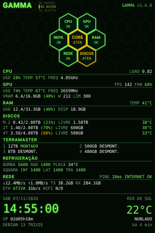
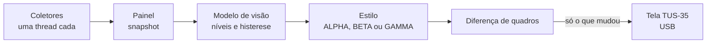

<!-- README | GAMMA TUS-35 | versão 2.2.0 | 07/11/2026 21:14 (-03) | criação original (Claude, para Lucas Tavares) -->
<!-- histórico: 1.0.0 02/11/2026 19:20 primeira página (SENTINELA e DOSÍMETRO) -->

<div align="center">

# GAMMA TUS-35

**Painel de monitoramento do PC para a telinha USB TURZX / Turing de 3,5", no Linux.**

Verde fluorescente, favo de hexágonos e brilho: CPU, GPU, RAM, discos, ventoinhas, bomba do water cooler, rede, clima e o gabinete de discos externo, tudo numa tela vertical de 320x480 pixels.




<sub>Esquema ilustrativo do layout do GAMMA GAMMA (não é uma captura da tela).</sub>

</div>

---

## O que é

O GAMMA transforma uma tela USB barata de 3,5" (TURZX / Turing Smart Screen TUS-35, USB `1a86:5722`) num painel de saúde do computador que fica ao lado do monitor. Ele roda como extensão do projeto de código aberto [turing-smart-screen-python](https://github.com/mathoudebine/turing-smart-screen-python), mas não usa os widgets prontos dos temas: o quadro inteiro é desenhado em Python com Pillow e só as regiões que mudaram são enviadas pela USB.

A ideia central é que **a tela diga em um segundo se está tudo bem**. Cada número tem cor de saúde (verde, âmbar, vermelho), e um indicador geral no topo resume o pior estado do sistema em três níveis: **N0 NORMAL**, **N1 AVISO** e **N2 ALERTA**, com o crítico piscando.

## Os estilos

| | GAMMA ALPHA | GAMMA BETA | GAMMA GAMMA |
|---|---|---|---|
| Ideia | Favo de 19 hexágonos com todos os números e linhas de texto abaixo | Igual ao ALPHA, mais compacto e com o gabinete de discos | Layout por grupos: 7 hexágonos de resumo e painel numérico |
| Destaque | Escala N0/N1/N2, percentuais, bomba e ventoinhas | Percentuais entre parênteses, DISP, LIVRE e LIM junto do uso, 4 baias do TerraMaster em 2x2 | CORE no centro, estado OK, ATEN ou CRIT por grupo, temperatura de cada disco, grupo TERRAMASTER |
| Nome antigo | SENTINELA | DOSÍMETRO | (novo) |
| Pacote | `Gamma-Alpha-v1.8.1.zip` | `Gamma-Beta-v1.8.1.zip` | `Gamma-Gamma-v1.8.1.zip` |

O **GAMMA DELTA** (`Gamma-Delta-v1.8.1.zip`, `--versao delta`) é o mais novo: o GAMMA GAMMA com gráficos de 24 h no alto e o pico de cada um, valores em alerta com fundo âmbar ou vermelho, total dos HDs num hexágono, barra de uso da RAM e LOG dos alertas. Detalhes de cada um em [docs/estilos.md](docs/estilos.md).

## O que aparece na tela

- **CPU:** uso, temperatura, frequência e carga média.
- **GPU NVIDIA:** uso, temperatura, frequência, VRAM, consumo e limite em watts, percentual da ventoinha e FPS dos jogos (via MangoHud).
- **RAM:** uso, disponível e temperatura dos pentes.
- **Discos:** uso, espaço livre e temperatura de cada disco (NVMe direto, HDD pelo módulo `drivetemp`).
- **Gabinete TerraMaster (DAS USB):** cada uma das 4 baias com capacidade e estado (montado, desmontado ou livre), detectado sozinho.
- **Refrigeração:** RPM da bomba, do radiador e de cada ventoinha do gabinete, com alerta de bomba parada.
- **Rede:** velocidade, totais, Ethernet e Wi-Fi, ping e estado da internet.
- **Sistema e clima:** data, hora, uptime, sistema operacional e o tempo da sua cidade (Open-Meteo).

## Instalação rápida

⚠️ Num Debian 13 (ou derivado) com a tela conectada, como usuário comum (nunca com `sudo`):

```bash
unzip Gamma-Gamma-v1.8.1.zip && cd Gamma-Gamma-v1.8.1 && ./instalar-gamma.sh
```

O instalador faz tudo em sequência: dependências, permissão da porta serial (grupo `dialout`), download do Turing Smart Screen, drivers de sensores (`nct6775` e `drivetemp`), serviço systemd de usuário e o tema. Para instalar direto deste repositório, sem ZIP:

```bash
./instalar-gamma.sh --versao gamma
```

Imagem de ponta-cabeça? `./instalar-gamma.sh --invertido`. Quer voltar ao tema anterior? `./instalar-gamma.sh --restaurar`. Guia completo em [docs/instalacao.md](docs/instalacao.md).

## Como funciona, em uma figura



Cada coletor (CPU, GPU, discos, rede, clima...) roda isolado: se um falhar, os outros continuam e a tela avisa "coleta parcial". Explicação completa em [docs/arquitetura.md](docs/arquitetura.md).

## Documentação

| Documento | Para quem | Conteúdo |
|---|---|---|
| [Estilos](docs/estilos.md) | quem vai usar | os quatro estilos, cores, estados e o que cada área mostra |
| [Instalação](docs/instalacao.md) | quem vai usar | instalador, opções, diagnóstico e restauração |
| [Configuração](docs/configuracao.md) | quem vai ajustar | `config.yaml`, limites de alerta, ventoinhas, discos e baias |
| [Hardware de referência](docs/hardware-de-referencia.md) | quem tem máquina parecida | o PC em que o GAMMA foi feito e como cada sensor é lido |
| [Arquitetura](docs/arquitetura.md) | quem vai mexer no código | fluxo de dados, mapa do código e conceitos |
| [Desenvolvimento](docs/desenvolvimento.md) | quem vai mexer no código | testes, prévias, geração dos ZIPs, versão e critérios de pronto |
| [Decisões e lições](docs/decisoes-e-licoes.md) | todos | por que o projeto é como é e os erros que não devem voltar |
| [Roteiro](docs/roteiro.md) | todos | pendências e próximos passos |
| [Brainstorm](docs/brainstorm/README.md) | todos | as 12 propostas da v2.0.0 e as variantes de estudo do DELTA, com imagens |
| [Histórico de versões](CHANGELOG.md) | todos | o que mudou em cada versão |

## Estado do projeto

Versão **1.8.1** (07/11/2026). O código foi testado em ambiente de desenvolvimento: autoteste com 135 de 135 verificações no repositório e 82 de 82 em cada pacote, e prévias sem nenhum problema de layout. **Ainda falta validar no hardware real** a tela física, o mapeamento das ventoinhas e a numeração das baias. Veja o [roteiro](docs/roteiro.md).

## Créditos e licença

- Projeto pessoal de Lucas Tavares. Design, código, scripts e documentação: criação original de Claude (Anthropic) para Lucas Tavares.
- Base: [turing-smart-screen-python](https://github.com/mathoudebine/turing-smart-screen-python), de Matthieu Houdebine e colaboradores (GPL-3.0).
- Fontes JetBrains Mono e Roboto (licença SIL OFL), usadas a partir do próprio Turing Smart Screen, sem redistribuição.
- Clima: [Open-Meteo](https://open-meteo.com). FPS: [MangoHud](https://github.com/flightlessmango/MangoHud).
- Licença: GPL-3.0-or-later, a mesma do projeto em que a extensão se integra. Texto em [LICENSE](LICENSE).
