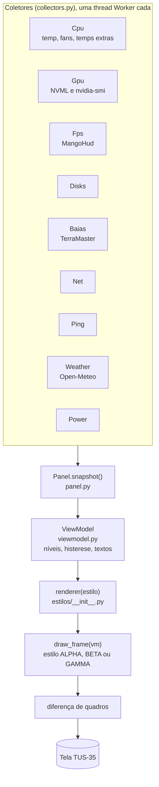

<!-- docs/arquitetura.md | versão 1.0.0 | 07/11/2026 15:25 (-03) | criação original (Claude, para Lucas Tavares). Fonte: código da v1.6.0 em pacote/. -->

# Arquitetura

[Voltar ao README](../README.md)

## Visão geral

O Turing Smart Screen tem um sistema de temas em YAML com widgets prontos (texto, barra, gráfico). Ele não atende o GAMMA: as cores são fixas, só lê um disco, não tem ventoinhas por papel, rede por interface nem estado da coleta. Por isso o tema `MatrixGreenPro` declara um único sensor personalizado, `MatrixGreenProPanel`, no mecanismo oficial `STATS.CUSTOM` (`library/sensors/sensors_custom.py`). Esse sensor desenha o quadro inteiro de 320x480 com Pillow e envia à tela só as regiões que mudaram, pela mesma fila e trava USB do programa. A cada `refresh_full_s` (padrão 300 s) há um redesenho completo.

## As camadas

1. **Coletores** (`collectors.py`). Cada fonte roda numa thread própria (`Worker`) com intervalo próprio e entrega leituras brutas. A falha de um coletor não derruba os outros: vira "COLETA PARCIAL", que é independente da saúde do computador.
2. **Painel** (`panel.py`). `Panel.snapshot()` junta as leituras. Há um modo de demonstração (`demo_snapshot`) com cenários normal, atenção e crítico, usado nas prévias e nos testes.
3. **Modelo de visão** (`viewmodel.py`, classe `ViewModel`). Transforma leituras em textos e níveis de saúde, com histerese (`Hyst`, em `alerts.py`) para não piscar entre cores. Produz o dicionário `vm`, com chaves como `cpu_util`, `cpu_temp`, `pump`, `fan_sqi`, `t_ram`, `disks`, `baias`, `hdr_status`, `slv` (pior nível) e `blink` (fase do piscar).
4. **Estilos** (`estilos/`). Cada estilo expõe `draw_frame(vm)` e desenha com a classe `Canvas` (`estilos/base.py`). `estilos/__init__.py` mantém o registro `ESTILOS`, os apelidos `ALIASES` e a função `renderer(nome)`.

## Estados

`OK`, `WARN`, `CRIT`, `NA` (sensor inexistente, cinza), `LOST` (sensor que existia e sumiu, amarelo) e `NEUTRAL` (número sem semântica de saúde). O cabeçalho usa `hdr_status` e `slv` para a escala N0/N1/N2 e a contagem de alertas. Cada indicador conta uma vez; utilização de CPU e GPU nunca conta como alerta.

## Mapa do código

| Caminho | Papel |
|---|---|
| `pacote/MatrixGreenPro/` | pasta do tema: `theme.yaml`, `background.png`, `preview.png` |
| `pacote/sensors/sensors_custom_hook.txt` | bloco acrescentado ao `sensors_custom.py` do Turing |
| `pacote/sensors/matrixgreenpro/collectors.py` | `Cpu`, `Gpu`, `Fps`, `Disks`, `Baias`, `Net`, `Ping`, `Weather`, `Power`; helpers `_hwmon_fans`, `_hwmon_temps`, `_bloco_base`, `_temp_bloco`, `_disco_rotativo` |
| `pacote/sensors/matrixgreenpro/settings.py` | valores padrão e leitura do `config.yaml` e do `fans.yaml` |
| `pacote/sensors/matrixgreenpro/alerts.py` | estados, paleta e histerese |
| `pacote/sensors/matrixgreenpro/viewmodel.py` | níveis, histerese e formatação (`disk_use`, `cap_txt` e outros) |
| `pacote/sensors/matrixgreenpro/panel.py` | sensor `MatrixGreenProPanel`, motor, demonstração e envio à tela |
| `pacote/sensors/matrixgreenpro/render.py` | desenho do estilo `matrix`, usado como reserva |
| `pacote/sensors/matrixgreenpro/versao.py` | `VERSAO` (no repositório fica `dev`; o construtor grava a versão do lançamento) |
| `pacote/sensors/matrixgreenpro/estilos/base.py` | `Canvas` (texto, linhas, polígonos, checagem de sobreposição e glifos), `VM` (marca métricas usadas), `REQUIRED` (cobertura obrigatória), `iface_row`, `selo_versao`, `bloom` |
| `pacote/sensors/matrixgreenpro/estilos/reator.py` | motor do ALPHA e do BETA: favo de 19 células, `cell_values`, hexágono, linhas de texto. Flags da paleta `P`: `alert`, `pct`, `flow`, `cool`, `temps`, `baias`, `selo` |
| `pacote/sensors/matrixgreenpro/estilos/reator_grupos.py` | motor do GAMMA GAMMA (colmeia, `_resumos`, painel por grupo) |
| `pacote/sensors/matrixgreenpro/estilos/alerta.py` | indicadores de alerta (`draw_status`, escala N0/N1/N2, brilho) |
| `pacote/sensors/matrixgreenpro/estilos/reator_gamma*.py` | paleta `GAMMA` e os estilos (entregues e experimentais) |
| `pacote/scripts/` | `instalar.sh`, `restaurar.sh`, `diagnosticar.sh` |
| `pacote/tools/` | `mgp_selftest.py`, `mgp_preview.py`, `mgp_mapear_fans.py`, `mgp_baias.py`, `mgp_detect.py`, `mgp_orientation_test.py` |
| `instalar-gamma.sh` | instalador de ponta a ponta |
| `construir/construir_zips.py` | gera os três ZIPs enxutos |

## Como um estilo novo entra

1. Criar `estilos/reator_<nome>.py` com `draw_frame(vm)` que devolve o `Canvas`.
2. Registrar em `ESTILOS` (e, se for o caso, em `ALIASES`) no `estilos/__init__.py`.
3. Usar o acesso `VM` para que a cobertura de métricas (`REQUIRED`) seja verificada.
4. Rodar o autoteste e as prévias (veja [desenvolvimento](desenvolvimento.md)).
5. Para virar entrega, adicionar a linha em `V` no `construir/construir_zips.py`.
