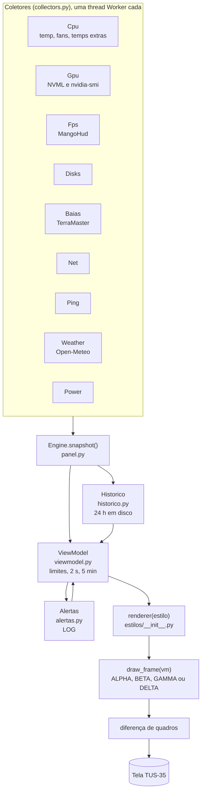

<!-- docs/arquitetura.md | versão 2.0.0 | 07/11/2026 22:24 (-03) | criação original (Claude, para Lucas Tavares). Fonte: código da v1.8.2 em pacote/. -->
<!-- histórico: 2.0.0 07/11/2026 22:24 revisão para a v1.8.2: histórico, alertas confirmados, LOG, GAMMA DELTA, estudos -->

# Arquitetura

[Voltar ao README](../README.md)

## Visão geral

O Turing Smart Screen tem um sistema de temas em YAML com widgets prontos (texto, barra, gráfico). Ele não atende o GAMMA: as cores são fixas, só lê um disco, não tem ventoinhas por papel, rede por interface nem estado da coleta. Por isso o tema `MatrixGreenPro` declara um único sensor personalizado, `MatrixGreenProPanel`, no mecanismo oficial `STATS.CUSTOM` (`library/sensors/sensors_custom.py`). Esse sensor desenha o quadro inteiro de 320x480 com Pillow a cada segundo e envia à tela só as regiões que mudaram, pela mesma fila e trava USB do programa. A cada `refresh_full_s` (padrão 300 s) há um redesenho completo.

## As camadas

1. **Coletores** (`collectors.py`). Cada fonte roda numa thread própria (`Worker`) com intervalo próprio e entrega leituras brutas: CPU e rede a cada quadro, GPU a cada 1,5 s, ping a cada 5 s, discos e baias a cada 10 s. A falha de um coletor não derruba os outros: vira "COLETA PARCIAL", que é independente da saúde do computador. Discos e baias seguem os dispositivos de VeraCrypt, LUKS e LVM (`_fisicos`) até o disco físico.
2. **Painel** (`panel.py`). `Engine.snapshot()` junta as leituras e acrescenta as séries de 24 h. Há um modo de demonstração (`demo_snapshot`) com cenários normal, atenção e crítico, usado nas prévias e nos testes.
3. **Histórico** (`historico.py`). Guarda média e máximo de cada intervalo (148 por dia) de temperatura de CPU e GPU, VRAM, RAM e rede, em `~/.local/state/matrixgreenpro/historico.json`.
4. **Modelo de visão** (`viewmodel.py`, classe `ViewModel`). Transforma leituras em textos e níveis de saúde. Cada nível passa por três filtros de `alerts.py`: `Hyst` (histerese, para não piscar), `Confirma` (sobe só depois de 2 s; âmbar e vermelho ficam no mínimo 5 min) e `Sustentado` (CPU e carga acima do limite por 5 min seguidos). Também calcula o total de todos os HDs (`total_hd`). Produz o dicionário `vm`, com chaves como `cpu_util`, `cpu_temp`, `pump`, `t_ram`, `disks`, `baias`, `total_hd`, `hist`, `registro`, `hdr_status` e `blink`.
5. **Alertas** (`alertas.py`). Registra no LOG cada indicador que entra em âmbar ou vermelho, com hora e leitura.
6. **Estilos** (`estilos/`). Cada estilo expõe `draw_frame(vm)` e desenha com a classe `Canvas` (`estilos/base.py`). `estilos/__init__.py` mantém o registro `ESTILOS`, os apelidos `ALIASES` e a função `renderer(nome)`.

## Estados

`OK`, `WARN`, `CRIT`, `NA` (sensor inexistente, cinza), `LOST` (sensor que existia e sumiu, âmbar) e `NEUTRAL` (número sem semântica de saúde). O cabeçalho usa `hdr_status` e `slv` para a escala N0/N1/N2 e a contagem de alertas. Cada indicador conta uma vez; o uso da GPU nunca conta como alerta, e o da CPU só depois de 5 minutos seguidos acima de 90 %.

## Mapa do código

| Caminho | Papel |
|---|---|
| `pacote/MatrixGreenPro/` | pasta do tema: `theme.yaml`, `background.png`, `preview.png` |
| `pacote/sensors/sensors_custom_hook.txt` | bloco acrescentado ao `sensors_custom.py` do Turing |
| `pacote/sensors/matrixgreenpro/collectors.py` | `Cpu`, `Gpu` (inclui os motivos de redução de clock da NVML), `Fps`, `Disks`, `Baias`, `Net`, `Ping`, `Weather`, `Power`; helpers `_hwmon_fans`, `_hwmon_temps`, `_fisicos`, `_bloco_base`, `_temp_bloco`, `_disco_rotativo` |
| `pacote/sensors/matrixgreenpro/settings.py` | valores padrão (limites, histerese, `alertas`) e leitura do `config.yaml` e do `fans.yaml` |
| `pacote/sensors/matrixgreenpro/alerts.py` | estados, paleta, `Hyst`, `Streak`, `Confirma` e `Sustentado` |
| `pacote/sensors/matrixgreenpro/viewmodel.py` | níveis, filtros, total dos HDs e formatação (`disk_use`, `cap_txt`, `rate` e outros) |
| `pacote/sensors/matrixgreenpro/alertas.py` | LOG de alertas (`Alertas`) |
| `pacote/sensors/matrixgreenpro/historico.py` | histórico de 24 h (`Historico`) e as séries de demonstração |
| `pacote/sensors/matrixgreenpro/brusco.py` | detector de mudanças bruscas (só nas variantes de estudo do DELTA) |
| `pacote/sensors/matrixgreenpro/panel.py` | sensor `MatrixGreenProPanel`, motor (`Engine`), demonstração e envio à tela |
| `pacote/sensors/matrixgreenpro/render.py` | desenho do estilo `matrix`, usado como reserva |
| `pacote/sensors/matrixgreenpro/versao.py` | `VERSAO` (no repositório fica `dev`; o construtor grava a versão do lançamento) |
| `pacote/sensors/matrixgreenpro/estilos/base.py` | `Canvas` (texto, linhas, polígonos, checagem de sobreposição e glifos), `VM` (marca métricas usadas), `REQUIRED` (cobertura obrigatória), `iface_row`, `selo_versao`, `bloom` |
| `pacote/sensors/matrixgreenpro/estilos/reator.py` | motor do ALPHA e do BETA: favo de 19 células, `cell_values`, hexágono, linhas de texto |
| `pacote/sensors/matrixgreenpro/estilos/reator_grupos.py` | motor do GAMMA GAMMA (colmeia, `_resumos`, painel por grupo) |
| `pacote/sensors/matrixgreenpro/estilos/reator_delta2.py` | motor do GAMMA DELTA e das variantes (alertas em destaque, hexágono do total, barra da RAM, LOG) |
| `pacote/sensors/matrixgreenpro/estilos/graficos.py` | gráficos de 24 h com o pico marcado e os nomes girados |
| `pacote/sensors/matrixgreenpro/estilos/alerta.py` | indicadores de alerta (`draw_status`, escala N0/N1/N2, brilho) |
| `pacote/sensors/matrixgreenpro/estilos/reator_gamma*.py` | paleta `GAMMA` e os estilos (entregues e de estudo) |
| `pacote/sensors/matrixgreenpro/estilos/v2_*.py` | as 12 propostas da v2.0.0 (base comum em `v2_base.py`) |
| `pacote/scripts/` | `instalar.sh`, `restaurar.sh`, `diagnosticar.sh` |
| `pacote/tools/` | `mgp_selftest.py`, `mgp_preview.py`, `mgp_mapear_fans.py`, `mgp_baias.py`, `mgp_detect.py`, `mgp_orientation_test.py` |
| `instalar-gamma.sh` | instalador de ponta a ponta |
| `construir/construir_zips.py` | gera os quatro ZIPs enxutos |
| `construir/matriz_previas.py` | matriz de prévias (4 estilos x 3 estados) |
| `construir/aplicar-na-tela.sh` | aplica um estilo na tela do PC a partir do ZIP |

## Como um estilo novo entra

1. Criar `estilos/reator_<nome>.py` com `draw_frame(vm)` que devolve o `Canvas` e o `VM`.
2. Registrar em `ESTILOS` (e, se for o caso, em `ALIASES`) no `estilos/__init__.py`. O instalador aceita qualquer nome registrado ali.
3. Usar o acesso `VM` para que a cobertura de métricas (`REQUIRED`) seja verificada.
4. Acrescentar o estilo à lista do autoteste (antes de `"pcb"`, que fica por último) e ao dicionário de nomes do `mgp_preview.py`.
5. Rodar o autoteste e as prévias (veja [desenvolvimento](desenvolvimento.md)).
6. Para virar entrega, adicionar a linha em `V` no `construir/construir_zips.py` (e os arquivos extras do motor na regra de cópia).
