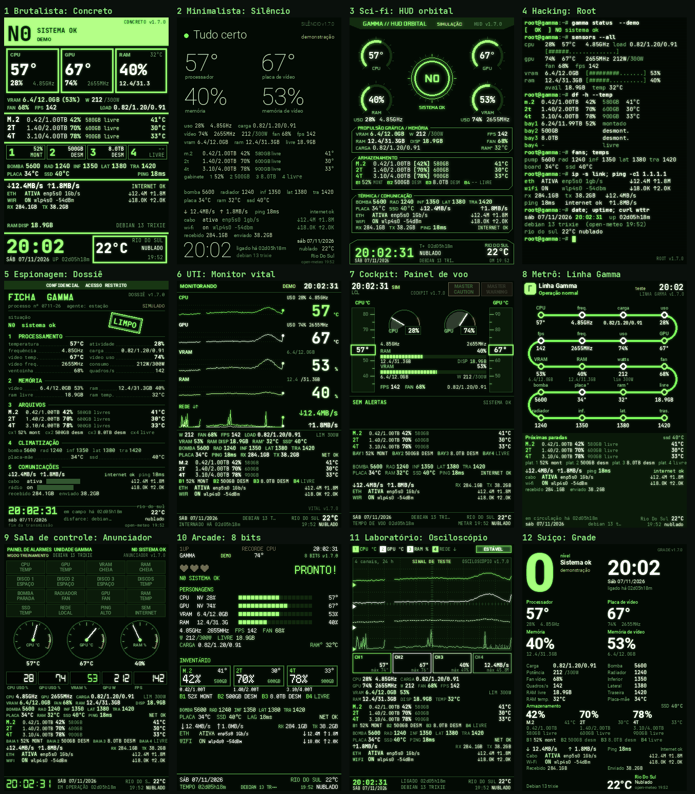
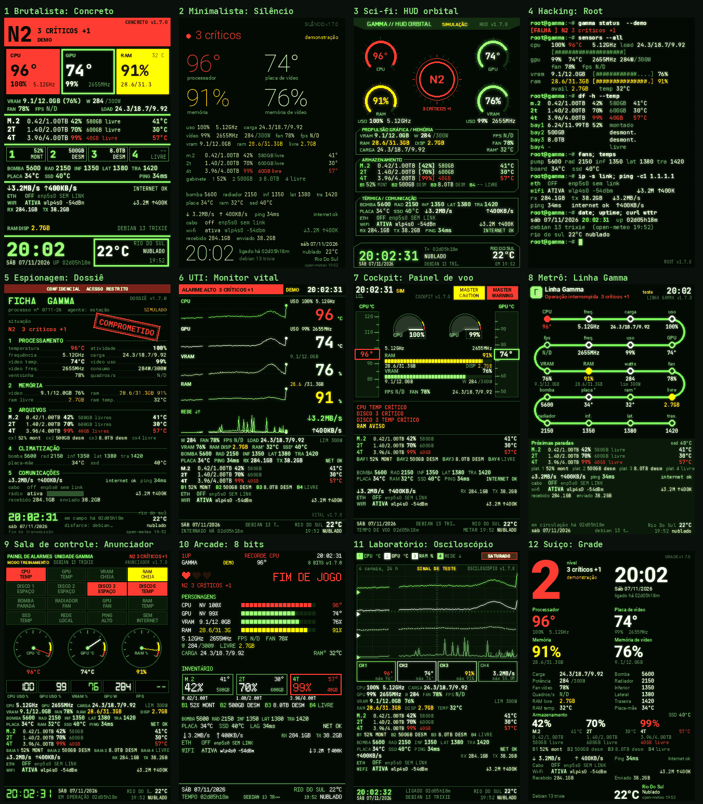
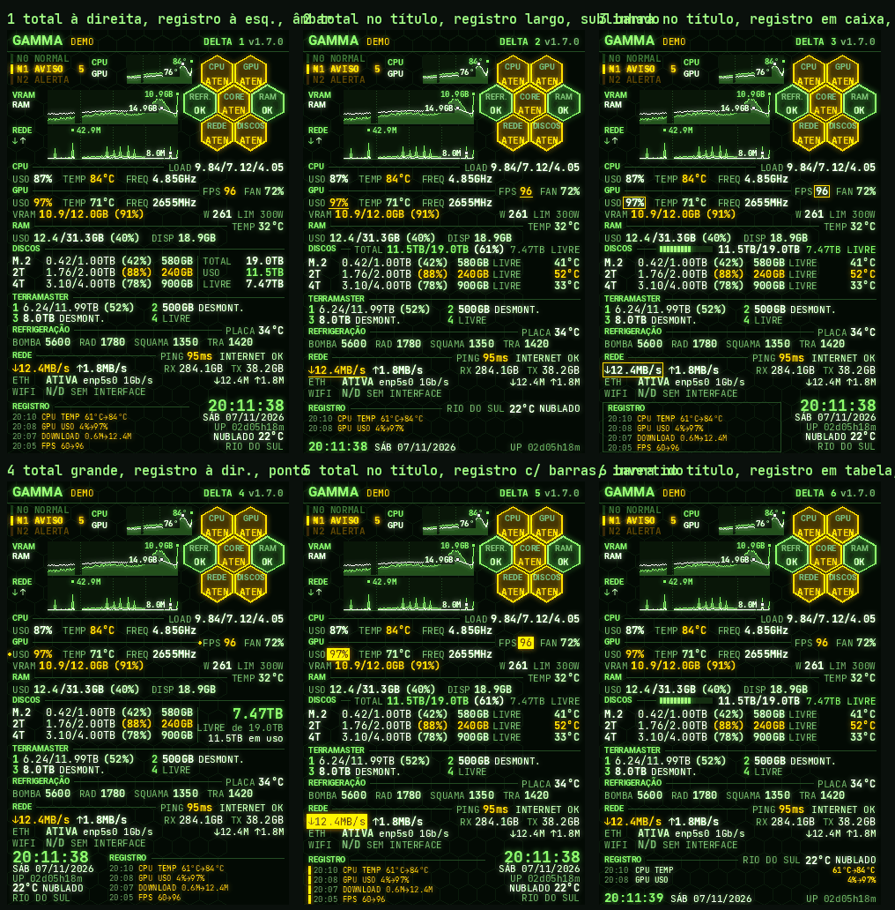
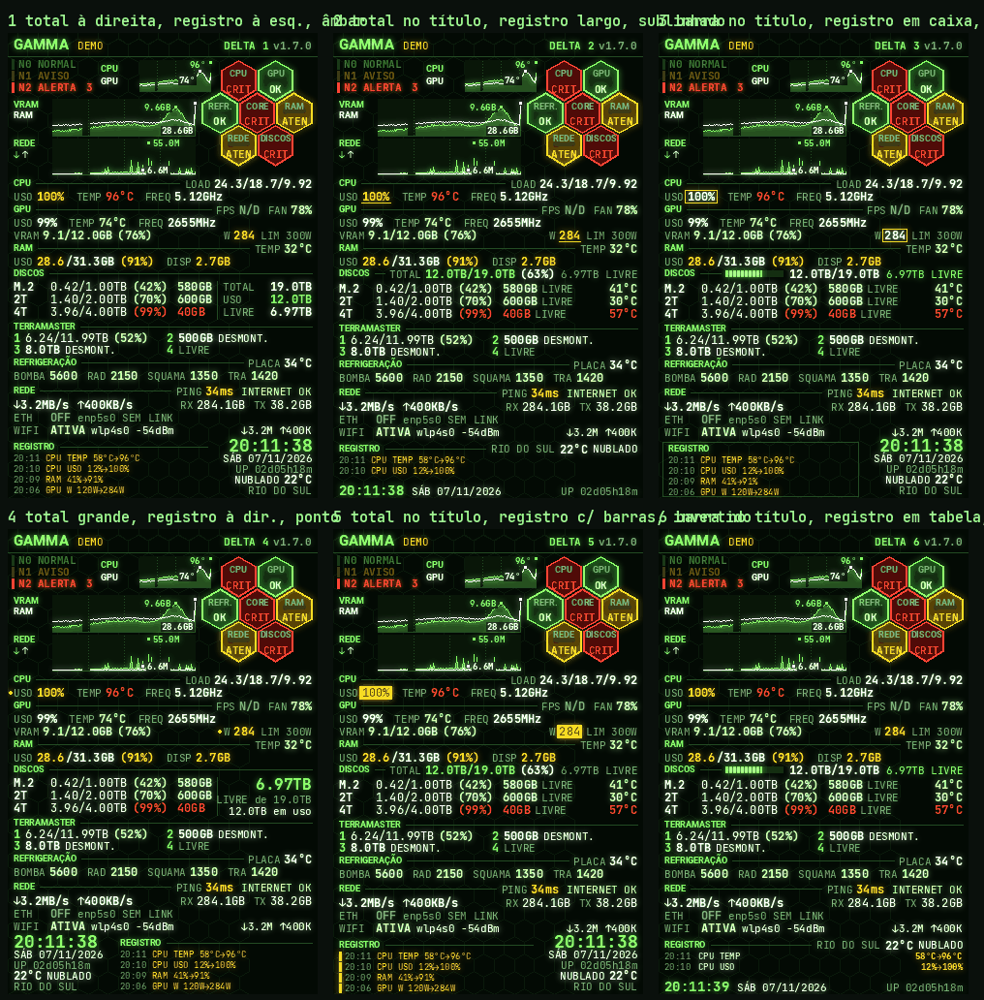
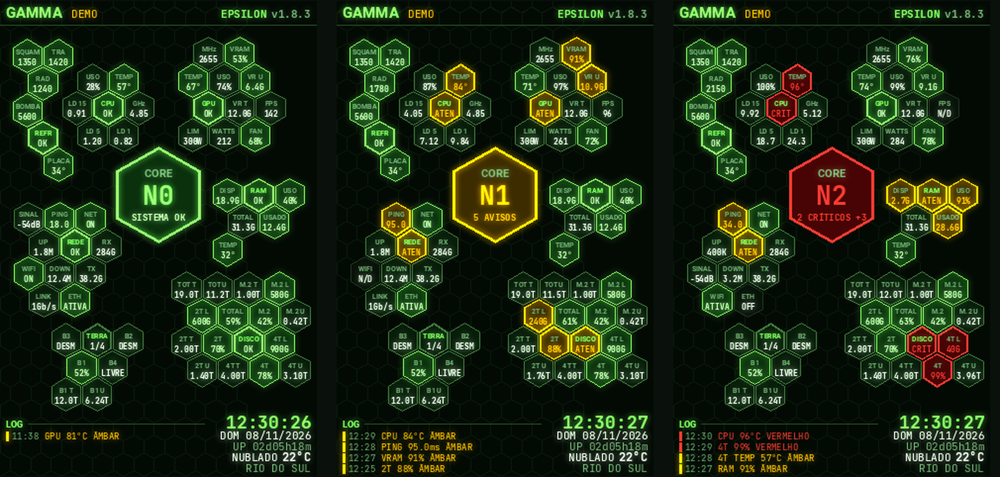

<!-- docs/brainstorm/README.md | versão 1.1.0 | 08/11/2026 12:35 (-03) | criação original (Claude, para Lucas Tavares). Fonte: estilos v2-*, gamma-delta-1 a 6 e gamma-epsilon do repositório. -->
<!-- histórico: 1.1.0 08/11/2026 12:35 protótipo GAMMA EPSILON -->

# Brainstorm para novas versões

[Voltar ao README](../../README.md)

Ideias guardadas para as próximas versões. Nada aqui é entregue nos ZIPs. Todos os estilos estão no código (`pacote/sensors/matrixgreenpro/estilos/`) e podem ser vistos com `--estilo NOME` no instalador ou com a matriz de prévias. As imagens são quadros desenhados com os dados de demonstração, não fotos da tela física.

## v2.0.0: 12 temas com a mesma paleta

Pedido de 07/11/2026: manter as cores do GAMMA e mudar o desenho por completo. Base comum em `v2_base.py`. Matriz: `python3 -I construir/matriz_previas.py previas/matriz-v2.png ~/turing-smart-screen-linux --v2`.

| Estilo | Tema | Ideia central |
|---|---|---|
| `v2-concreto` | Brutalista | Laje do estado no topo com o nível gigante; blocos de borda grossa que se enchem de cor no alerta |
| `v2-silencio` | Minimalista | Uma frase ("Tudo certo"), quatro números finos, nenhuma linha ou caixa |
| `v2-hud` | Sci-fi | Anel central do N0/N1/N2 e quatro mostradores em arco; painéis de cantos cortados |
| `v2-root` | Hacking | Sessão de terminal: cada grupo é a saída de um comando, com barras ASCII e cursor |
| `v2-dossie` | Espionagem | Ficha confidencial, carimbo girado (LIMPO, SOB VIGILÂNCIA, COMPROMETIDO), tarjas de censura |
| `v2-vital` | UTI | Monitor de leito: cinco canais com traçado de 24 h e número grande; faixa de alarme |
| `v2-cockpit` | Cockpit | MASTER CAUTION e WARNING, fitas rolantes de temperatura, mostradores de motor, mensagens ECAM |
| `v2-metro` | Metrô | Uma linha serpenteando pela tela; cada métrica é uma estação |
| `v2-anunciador` | Sala de controle | Painel anunciador de 16 janelas, medidores de ponteiro e sete segmentos |
| `v2-8bits` | Arcade | Fonte de pixel, vidas em corações, FIM DE JOGO no crítico, discos como inventário |
| `v2-osciloscopio` | Laboratório | Retícula com quatro canais de 24 h e caixas de medição |
| `v2-grade` | Suíço | Duas colunas rígidas e o nível como algarismo enorme |

## GAMMA DELTA: 6 variantes de estudo

Total de TB de todos os HDs, marca de mudanças bruscas (âmbar por até 10 min depois de normalizar), refrigeração numa linha e registro das mudanças. Motor em `reator_delta2.py`; estilos `gamma-delta-1` a `gamma-delta-6`. Matriz: `--deltas`. Preferida pelo Lucas: a 5, com a barra de ocupação dos discos da 6.

## GAMMA EPSILON: protótipo parado

Pedido de 08/11/2026: todos os dados do DELTA (menos os gráficos) como células de colmeia em volta de um CORE grande, agrupadas por categoria: CPU, GPU, RAM, DISCOS, TERRAMASTER, REFRIGERAÇÃO e REDE. Dentro do grupo, as células ficam a 2 px umas das outras; entre grupos e até o CORE, 2 mm (cerca de 13 px). Em DISCOS e TERRAMASTER, cada disco e cada baia encostam no centro do grupo, com U, T e L do lado de fora. O LOG, o relógio e o clima continuam no rodapé.

Estilo `gamma-epsilon` (`reator_gamma_epsilon.py`, versão 0.6.0). Matriz: `--extra epsilon`. As células são posicionadas sozinhas (`_empacotar`); os centros dos grupos (`LUGARES`) saíram de uma busca que exige caber tudo nos 3 estados, com 1 ou 4 baias montadas. Se algo não couber, o quadro mostra "não coube" no alto.

Decisão do Lucas: fica como protótipo, não está pronto para lançamento e o desenvolvimento parou por ora. Pendências conhecidas: a célula DISCO fica perto da borda de baixo do grupo, a leitura exige atenção (muitas células pequenas, fontes de 7 e 8 px) e o encaixe depende do número de discos e baias.

