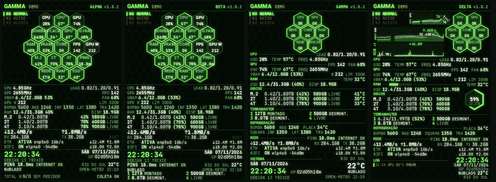
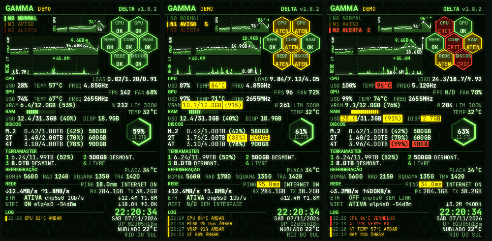

<!-- docs/estilos.md | versão 2.0.0 | 07/11/2026 22:24 (-03) | criação original (Claude, para Lucas Tavares). Fonte: código da v1.8.2 (estilos/, reator_gamma.py, alerts.py) e histórico do projeto. -->
<!-- histórico: 2.0.0 07/11/2026 22:24 revisão para a v1.8.2: paleta com códigos, GAMMA DELTA reescrito, estudos atuais -->
<!-- histórico: 1.3.0 07/11/2026 19:40 gráficos de 24 h; 1.2.0 07/11/2026 19:00 GAMMA DELTA; 1.1.0 07/11/2026 18:45 variante COLUNA -->

# Estilos

O GAMMA tem quatro estilos de entrega: ALPHA, BETA, GAMMA e DELTA. Todos usam os mesmos dados, as mesmas regras de saúde e a mesma coleta: muda só o desenho. Todos mostram, no canto superior direito, o selo do estilo e da versão (por exemplo `DELTA v1.8.3`; instalado direto do repositório aparece `dev`).

[Voltar ao README](../README.md)

## Identidade visual

| Elemento | Valor |
|---|---|
| Tela | 320x480 pixels, retrato |
| Fontes | JetBrains Mono (números e dados) e Roboto (títulos e rótulos), ambas OFL, lidas do Turing Smart Screen |
| Fundo decorativo | malha de hexágonos de raio 12 em `#0A1A0B` |
| Acabamento | brilho (bloom) aplicado ao quadro inteiro no final |

### Paleta

Definida em `pacote/sensors/matrixgreenpro/estilos/reator_gamma.py` (dicionário `GAMMA`).

| Nome no código | Cor | Hexadecimal | RGB | Uso |
|---|---|---|---|---|
| `bg` | quase preto | `#030A04` | 3, 10, 4 | fundo da tela; texto sobre fundo de alerta |
| `accent` | verde fluorescente | `#78FF5A` | 120, 255, 90 | títulos, nível N0, gráficos, barras |
| `ice` | verde-claro | `#BEFFAA` | 190, 255, 170 | valores em nível OK |
| `white` | branco esverdeado | `#E6FFE1` | 230, 255, 225 | números neutros, segunda série dos gráficos |
| `sub` | cinza-esverdeado | `#6EAA6E` | 110, 170, 110 | rótulos, N/D, versão no selo |
| `dim` | verde-escuro | `#234B23` | 35, 75, 35 | linhas, divisórias, marcas dos gráficos |
| `amber` | âmbar | `#FFBE00` | 255, 190, 0 | atenção (N1) e sensor perdido |
| `red` | vermelho | `#FF3C32` | 255, 60, 50 | crítico (N2) |

Hexágonos (preenchimento e borda) por estado:

| Estado | Preenchimento | Borda |
|---|---|---|
| OK | `#0A300C` | `#78FF5A` |
| Atenção | `#3C2C00` | `#FFBE00` |
| Crítico | `#480404` | `#FF3C32` |
| Sem dado (N/D) | `#081209` | `#1E341E` |
| Neutro | `#081C0A` | `#40783C` |

## Cores e estados

| Cor | Estado | Significado |
|---|---|---|
| Verde | `OK` | dentro do limite |
| Âmbar | `WARN` | atenção (N1) |
| Vermelho | `CRIT` | crítico (N2) |
| Cinza | `NA` | o sensor não existe nesta máquina (N/D), não alerta |
| Âmbar | `LOST` | o sensor existia e sumiu |
| Branco | `NEUTRAL` | número sem significado de saúde (por exemplo, tráfego de rede) |

No cabeçalho, a **escala N0 NORMAL, N1 AVISO, N2 ALERTA** mostra o pior nível do sistema; o nível ativo brilha e os outros ficam esmaecidos (no crítico, a barra pisca). Uma leitura contínua só muda de cor depois de 2 s, e âmbar e vermelho ficam no mínimo 5 minutos. Os limites e as fontes estão em [configuração](configuracao.md#limites-de-alerta).

## GAMMA ALPHA (`gamma-alpha`)

Nome antigo: GAMMA SENTINELA (apelidos aceitos: `gamma-sentinela`, `gamma-n3-esq`).

- **Cabeçalho:** título GAMMA, aviso DEMO (só no modo demonstração), escala N0/N1/N2 à esquerda, sem tarja, e selo à direita.
- **Favo de 19 hexágonos** em linhas de 3, 4, 5, 4 e 3: CPU, CPU°, GPU, BOMBA, PLACA, GPU°, G.FAN, RAM, VRAM, CORE (saúde geral), FPS, GPU W, os três discos (M.2, 2T, 4T), PING, REDE, RAM° e SSD°.
- **Linhas de texto abaixo:** CPU; GPU (VRAM, W, LIM, FPS e FAN %); RAM; refrigeração (BOMBA, RAD, INF, LAT e TRA em RPM); discos com uso, percentual e livre; rede (↓ ↑, RX, TX, ETH, WIFI); relógio grande, data, uptime e sistema; ping, internet e clima; rodapé com TOTAL W e COLETA.

## GAMMA BETA (`gamma-beta`)

Nome antigo: GAMMA DOSÍMETRO (apelidos aceitos: `gamma-dosimetro`, `gamma-n3-compacto`).

Igual ao ALPHA, com duas diferenças de texto e uma de conteúdo:

- Percentuais **entre parênteses** e na cor do nível: `VRAM 10.9/12.0GB (91%)`, `RAM 12.4/31.3GB (40%)`.
- Informações secundárias (DISP da RAM, LIVRE dos discos, LIM da GPU) **coladas logo depois do uso**, em vez de alinhadas à direita.
- **Baias do TerraMaster:** quando o gabinete é detectado, as 4 baias aparecem em 2x2 no rodapé, no lugar de TOTAL W e COLETA. Sem gabinete, o rodapé volta ao normal.

## GAMMA GAMMA (`gamma-gamma`)

Apelido aceito: `gamma-gamma-fronteira`.

**Colmeia de resumo.** Exatamente 7 hexágonos (raio 21, vão 2). CORE no centro; CPU e GPU em cima; REFR. e RAM nas laterais do CORE; REDE e DISCOS embaixo. Cada hexágono mostra só o nome e o estado `OK`, `ATEN` ou `CRIT` (`N/D` quando o grupo não tem nenhum dado). O estado do grupo é o pior nível entre os seus indicadores, e um sensor perdido (`LOST`) conta como atenção. O CORE é o pior estado geral, a mesma informação da escala N0/N1/N2.

**Painel numérico**, por grupo, com título e linha divisória. Para economizar espaço, um dado-chave vai no próprio título:

| Grupo | No título | Linhas |
|---|---|---|
| CPU | LOAD | USO, TEMP, FREQ |
| GPU | FPS e FAN | USO, TEMP, FREQ; VRAM com percentual, W e LIM |
| RAM | TEMP | USO com total e percentual, DISP |
| DISCOS | | nome, uso, percentual, livre e temperatura à direita |
| TERRAMASTER | | 4 baias em 2x2: número, capacidade e MONTADO, DESMONT. ou LIVRE (só com o gabinete conectado) |
| REFRIGERAÇÃO | | BOMBA, RAD, PLACA; SQUAMA INF, LAT, TRA |
| REDE | PING e internet | ↓ ↑, TX, RX; ETH e WIFI |

**Rodapé.** Sistema à esquerda (data acima da hora, uptime, sistema operacional) e clima no canto inferior direito (cidade, temperatura grande, condição do tempo e idade do dado).

## GAMMA DELTA (`gamma-delta`), o recomendado

O GAMMA GAMMA reorganizado, com gráficos de 24 h, alertas em destaque e um LOG. Pacote `Gamma-Delta-v1.8.3.zip`, instalado com `--versao delta`. Na 1.8.0 ele passou a ser o desenho estudado como DELTA 5B (o nome `gamma-delta-5b` continua aceito). Motor em `estilos/reator_delta2.py`.

- **Colmeia à direita.** Os mesmos 7 hexágonos do GAMMA GAMMA, com a borda direita em x = 314.
- **Gráficos de 24 h** no espaço livre do alto, com os nomes girados 90° e centrados na altura de cada gráfico. A primeira série é uma área verde e a segunda uma linha branca:
  - à direita da escala: temperatura da CPU e da GPU, de 20 a 100 °C;
  - VRAM e RAM, cada uma em percentual da própria capacidade;
  - rede: download e upload, com a escala ajustada ao pico do dia.

  A linha é a média de cada intervalo (cerca de 10 min por pixel). O **pico de 24 h** de cada série é um ponto no momento e na altura em que aconteceu, com o valor ao lado (VRAM e RAM em GB). Marcas pontilhadas a cada 6 h; a borda direita é agora; falha na linha = sem dado. O histórico (`historico.py`) fica em `~/.local/state/matrixgreenpro/historico.json` e sobrevive a reinícios.
- **Valor em alerta em destaque:** qualquer leitura em atenção ou crítico aparece com fundo âmbar ou vermelho e texto escuro (por exemplo `TEMP 84°C`, `PING 95.0ms`).
- **RAM** com barra de uso segmentada logo depois da palavra RAM.
- **Discos** com uso, percentual e livre; o canto direito do grupo traz o **total de todos os HDs** (discos e baias montadas, cada dispositivo uma vez, inclusive VeraCrypt e LUKS) num hexágono cujo contorno se enche com o uso, com o percentual e o total usado no centro.
- **TERRAMASTER** com uso nas baias montadas: `1 6.24/11.99TB (52%)`. A cor do percentual segue os limites dos discos, só como informação (não entra na saúde).
- **Refrigeração numa linha:** BOMBA, RAD, SQUAMA (INF e LAT estão em série; mostra a entrada que tem leitura) e TRA, com a PLACA no título.
- **REDE** com PING de uma casa decimal e `INTERNET ON` ou `OFF` no título.
- **LOG** no rodapé: os últimos alertas âmbar e vermelhos, com hora, item e leitura (a volta ao verde não entra); relógio, data, tempo ligado e clima à direita.
- Selo `DELTA` com a versão.

## Estilos de estudo (não entregues nos ZIPs)

Guardados como brainstorm, com imagens em [docs/brainstorm](brainstorm/README.md). Podem ser vistos com `--estilo NOME`, mas não recebem manutenção.

- **Propostas da v2.0.0:** `v2-concreto` (brutalista), `v2-silencio` (minimalista), `v2-hud` (sci-fi), `v2-root` (hacking), `v2-dossie` (espionagem), `v2-vital` (UTI), `v2-cockpit` (cockpit), `v2-metro` (metrô), `v2-anunciador` (sala de controle), `v2-8bits` (arcade), `v2-osciloscopio` (laboratório) e `v2-grade` (suíço).
- **Variantes do DELTA:** `gamma-delta-1` a `gamma-delta-6`, `gamma-delta-5a` e `gamma-delta-5c` (formas de mostrar o total dos discos, o registro e as marcas).
- **Variantes do GAMMA GAMMA:** `gamma-gamma-colmeia`, `gamma-gamma-mini`, `gamma-gamma-painel` e `gamma-gamma-coluna` (hexágonos em coluna, ao lado de cada grupo).
- **Legados:** `matrix` (minimalista, usado como reserva), `gamma` (o favo original), `gamma-sonar`, `gamma-raiox`, `gamma-uv`, `gamma-escala`, `gamma-barra`, `gamma-banner`, `gamma-faixa`, `gamma-n3`, `gamma-n3-abas`, `gamma-n3-linha`, `gamma-n3-eventos` e `pcb` (placa de circuito).

A decisão de arquivar ou remover está no [roteiro](roteiro.md).
