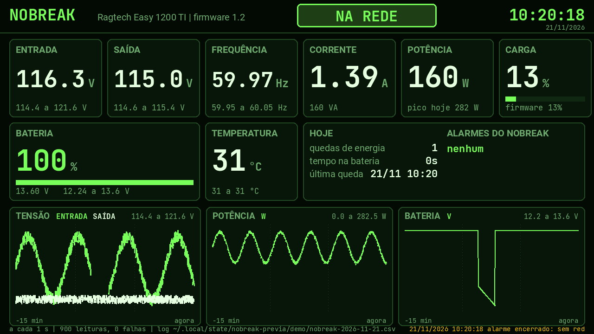

<!-- nobreak/README.md | versão 1.0.0 | 21/11/2026 10:20 (-03) | criação original (Claude, para Lucas Tavares) -->

# Tela do nobreak (TURZX de 5,2", paisagem)

A tela de 5,2" mostra só o nobreak Ragtech New Easy Pro NEP 1200 (modelo 4162), em paisagem (1280x720), atualizada a cada 1 segundo. Cada leitura também entra num log em CSV.



<sub>Dados de demonstração, com uma queda de energia no meio dos 15 minutos.</sub>

## O que aparece

- Estado em destaque: NA REDE (verde), NA BATERIA (âmbar) ou SEM LEITURA (vermelho).
- Entrada, saída, frequência, corrente, potência (V x A), carga (com a carga informada pelo firmware), bateria (% e V) e temperatura, cada um com o mínimo e o máximo do dia.
- O dia: quedas de energia, tempo na bateria, última queda e, durante uma queda, há quanto tempo está na bateria.
- Os alarmes do próprio nobreak (bateria fraca, sobrecarga, superaquecimento e outros). Só eles decidem âmbar e vermelho; nenhum limite foi inventado aqui.
- Gráficos dos últimos 15 minutos: tensão de entrada e de saída, potência e tensão da bateria.

## Como funciona

- Leitura: `ragtech_read.py`, do repositório `ragtech_4162` (só leitura, protocolo do driver `ragtech` do NUT). Este programa usa só a função `poll()` e nunca envia comando de escrita ao nobreak. A calibração dos valores é do leitor.
- Tela: biblioteca do turing-smart-screen-python (`LcdCommTuringUSB`), sem uma segunda instância do programa. A tela de 3,5" continua com o serviço do Turing.
- Log: `~/.local/state/nobreak/nobreak-AAAA-MM-DD.csv`, uma linha por leitura, separada por ponto e vírgula, com data e hora `dd/mm/aaaa HH:MM:SS`; eventos (quedas, volta da rede, alarmes, falhas de leitura) em `nobreak-eventos.log`.

## Instalar

⚠️ Uma vez só, libere a tela de 5,2" para o seu usuário (a regra que já existe no PC cobre só o produto `0028`):

```bash
sudo cp 99-turzx-52.rules /etc/udev/rules.d/ && sudo udevadm control --reload && sudo udevadm trigger
```

Depois, com o usuário comum:

```bash
./instalar.sh
```

Para parar: `./instalar.sh --parar`. Para ver um quadro sem usar a tela: `python3 nobreak_tela.py --previa quadro.png` (ou `--demo`).

Só um programa por vez pode ler a porta serial do nobreak. Com o serviço ligado, use o CSV do log em vez de rodar o `ragtech_read.py` em paralelo.
